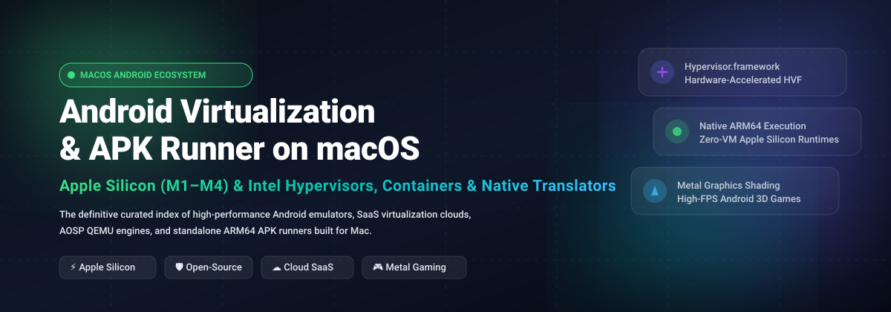

  

# 🚀 Awesome Android Virtualization & APK Runner on macOS 🍏🤖

  
  
  
  
  

---

## 📖 Top Android Virtualization & APK Runner on macOS Ecosystem

A curated directory and engineering index of top **SaaS / hosted platforms**, **open-source GitHub projects**, **Apple Silicon native translation runtimes**, and **hypervisor virtualization stacks** designed to run Android apps (APKs), mobile games, and full AOSP images on macOS (M1/M2/M3/M4 Apple Silicon & Intel).

> 🔍 **SEO & Architecture Highlights**: Covers macOS Android Emulators, Apple Silicon ARM64 hypervisors, `Hypervisor.framework` (HVF), AOSP Virtual Device emulation, Docker/Colima containerized Android (Redroid), Metal-accelerated graphics, and direct APK translation layers.

---

## 📑 Table of Contents
- [📊 Sector Overview & Market Dynamics](#-sector-overview--market-dynamics)
- [☁️ SaaS & Hosted Platforms](#️-saas--hosted-platforms)
- [🛠️ Open-Source GitHub Projects](#️-open-source-github-projects)
- [🤝 How to Contribute](#-how-to-contribute)
- [💖 Support & Sponsorship](#-support--sponsorship)
- [📈 Star History](#-star-history)
- [⚠️ Disclaimer](#️-disclaimer)

---

## 📊 Sector Overview & Market Dynamics

The global Android and mobile virtualization market is valued at approximately **$7.5B – $8.7B** in 2024–2025 (projected to reach **$11.8B – $14.2B+ by 2026** at a ~14–18% CAGR), while the dedicated consumer/desktop PC Android emulator & cloud streaming sector accounts for **$1.7B – $2.4B**. 

The sector is **moderately fragmented yet top-heavy**: consumer and gaming desktop emulation exhibits winner-take-most dynamics dominated by a small oligopoly of well-capitalized players (NetEase/MuMu, now.gg/BlueStacks, and Xuanzhi/LDPlayer), while the macOS developer, enterprise CI/CD testing, and native Apple Silicon virtualization spaces remain vibrant and open-source driven around Apple's `Hypervisor.framework`, QEMU, Redroid, and lightweight containerization.

---

## ☁️ SaaS & Hosted Platforms

Below is the comparative breakdown of commercial and hosted Android emulation / virtualization solutions for macOS, sorted descending by **Company Scale (Valuation / Revenue)**.

| Platform | Company Scale (Revenue / Valuation) | Pricing (Starting Tier) | Free Tier Limits / Free Trial | Target macOS Architecture & Features |
| :--- | :--- | :--- | :--- | :--- |
| **[MuMu Player Pro](https://mumuplayer.com)** | **$78B Market Cap / ~$18B Annual Revenue** *(NetEase, Inc. - NASDAQ: NTES)* | **$10.00/month** (or ~$6.00/month billed annually at $72.00/year) | **7-day full-featured free trial** on new Mac devices; subscription required thereafter | Apple Silicon (M1–M4) optimized; Metal-accelerated 3D graphics rendering, Android 12, multi-instance gaming. |
| **[BlueStacks (Air / now.gg)](https://bluestacks.com)** | **~$50M–$70M Annual Revenue / $48M+ VC Funded** *(Privately held, now.gg)* | **$7.99/month** (*BlueStacks Prime* ad-free tier) | **Free forever plan** supported by sponsored app suggestions and ads; 5,000 monthly AI credits & nowBux credits on Prime | Intel & Apple Silicon Macs; cloud streaming integration via now.gg, custom keyboard/mouse mapping, high-FPS modes. |
| **[NoxPlayer](https://bignox.com)** | **~$10M–$20M Estimated Annual Revenue** *(Privately held, BigNox)* | **$3.69/month** (*Nox Premium* ad-free tier; or $31.99/year) | **Free forever plan** with home screen sponsored ads and startup banners; up to 5 concurrent instances per account | Intel Macs (and Apple Silicon via Rosetta 2 / remote streaming); gamepad mapping, script recording, multi-instance sync. |
| **[LDPlayer](https://ldplayer.net)** | **~$10M–$20M Estimated Annual Revenue** *(Privately held, Xuanzhi)* | **$2.99/month** (*LD Premium* ad-free tier; or $29.99/year) | **Free forever plan** bundled with desktop ads and sponsor recommendations; unmetered local emulator instances | Primary PC build accessible on Mac via cloud streaming or Parallels/VM; ultra-high FPS, macro scripting, multi-drive management. |
| **[MEmu Play](https://memuplay.com)** | **~$5M–$15M Estimated Annual Revenue** *(Privately held, Microvirt)* | **$2.99/month** (*MEmu Premium* ad-free tier; or $29.98/year) | **Free forever plan** including banner ads; unlocks custom skins and dock positioning on Premium | Intel Macs / cloud streaming VM; flexible CPU/RAM allocation, GPS spoofing, OpenGL/DirectX rendering simulation. |
| **[Genymotion Desktop & Cloud](https://genymotion.com)** | **~$6M–$7M Annual Revenue** *(Acquired by Shadow / OVHcloud)* | **$19.99/month** (billed annually at $239.99/year per computer) | **Free for Personal Use plan**: 1 user, strictly non-commercial/academic use, limited to Android ≤15, restricted command-line `gmtool` | Intel & Apple Silicon ARM64 native; sensor simulation, ADB command interface, CI/CD automated pipeline integration. |
| **[Andy (Andyroid)](https://andyroid.net)** | **Legacy / <$2M Estimated Revenue** *(Privately held, Andy OS Inc.)* | **Free freeware tier** (historically monetized via bundled partner software) | **Free forever tier** with no upfront licensing cost; bundled with third-party software promotions | Intel Macs; syncs mobile notifications, full Android desktop UI emulation, phone-as-controller setup. |
| **[KoPlayer](https://koplayer.com)** | **Legacy / Independent** *(Privately held)* | **Free freeware tier** (monetized via in-client advertisements) | **Free forever tier** with ad-supported client; basic x86 Android emulation features | Intel Macs (legacy); direct APK sideloading, screen recording, built-in Google Play store support. |

---

## 🛠️ Open-Source GitHub Projects

The premier open-source repositories powering Android virtualization, APK translation, device streaming, and kernel-level emulation on macOS. **Sorted descending by GitHub Star Count.**

| Project | Stars Badge | Description & macOS Capabilities |
| :--- | :--- | :--- |
| **[scrcpy](https://github.com/Genymobile/scrcpy)** |  | High-speed, ultra-low-latency screen mirroring and input control tool for Android over USB/Wi-Fi on macOS; perfect companion for headless virtual Android instances. |
| **[termux-app](https://github.com/termux/termux-app)** |  | Powerful terminal emulator and Linux environment for Android, widely used inside macOS Android virtual machines and emulators for package management and CLI toolchains. |
| **[UTM](https://github.com/utmapp/UTM)** |  | Full-featured QEMU-based virtual machine host for macOS supporting Apple's `Hypervisor.framework` to boot ARM64 and x86_64 Android operating systems (Bliss OS, Android-x86). |
| **[colima](https://github.com/abiosoft/colima)** |  | Container runtimes on macOS with minimal setup; enables running cloud-native ARM64 Android Docker images (like Redroid) on Apple Silicon M-series Macs without Docker Desktop. |
| **[lima](https://github.com/lima-vm/lima)** |  | Linux virtual machines on macOS with automatic file sharing and port forwarding; hosts Waydroid and Redroid containers with native ARM64 CPU passthrough. |
| **[microG GmsCore](https://github.com/microg/GmsCore)** |  | FLOSS (Free/Libre Open Source Software) component that replaces proprietary Google Play Services inside macOS Android VMs and emulators, allowing Play-dependent apps to function. |
| **[qemu](https://github.com/qemu/qemu)** |  | Generic and open-source machine emulator and virtualizer; provides the underlying hypervisor virtualization engine (`-accel hvf`) powering Android Studio and UTM on macOS. |
| **[waydroid](https://github.com/waydroid/waydroid)** |  | Container-based approach to boot a complete Android system on a regular Linux system; run inside macOS Linux guests (Lima/UTM) to execute Android apps with near-native performance. |
| **[anbox](https://github.com/anbox/anbox)** |  | Container-based Android execution layer in user space; historical foundation for containerized Android execution inside lightweight virtual machines. |
| **[redroid](https://github.com/remote-android/redroid-doc)** |  | GPU-accelerated Remote-Android-in-Docker container solution; boots headless Android instances on macOS with Colima/Lima and streams screens via scrcpy or web browsers. |
| **[OpenGApps](https://github.com/opengapps/opengapps)** |  | Open-source package generator providing Google Play Store and Google Mobile Services packages for custom AOSP builds and macOS emulators. |
| **[Mac.apk](https://github.com/kksimp/Mac.apk)** |  | Native compatibility layer running Android APKs on Apple Silicon Macs without an emulator or VM, executing ARM code directly on the CPU with Metal GPU rendering. |
| **[android-cuttlefish](https://github.com/google/android-cuttlefish)** |  | Google's official reference AOSP virtual device framework; ported to run on macOS via Apple's Hypervisor framework for hardware-accurate Android operating system testing. |
| **[android-emulator-m1-preview](https://github.com/741g/android-emulator-m1-preview)** |  | Pioneering open-source Apple Silicon M1 proof-of-concept demonstrating ARM64 Android virtualization on macOS using `Hypervisor.framework`. |
| **[Bliss OS Manifest](https://github.com/BlissRoms-x86/manifest)** |  | Open-source Android-based desktop operating system with desktop UI, taskbar, and multi-window features built for virtualization in UTM and QEMU on macOS. |

---

## 🤝 How to Contribute

Contributions, project submissions, and suggestions are welcome!

1. 🍴 **Fork the repository** on GitHub.
2. 📝 **Add or edit entries** in `README.md` following the established table formats.
3. 🔎 **Provide accurate details**: platform name, starting tier price, free tier/trial limits, valuation/revenue scale, and official links.
4. 🚀 **Submit a Pull Request** with a descriptive summary of your additions.

---

## 💖 Support & Sponsorship

If you find this curated directory helpful for your development workflow, testing pipelines, or Mac gaming setups:

- ⭐ **Star this repository** to show your appreciation!
- 🍴 **Fork and share** with colleagues and Android/macOS developer communities.
- ☕ **Support the maintainer**: Buy a coffee or support continuous maintenance via the [GitHub Sponsor Dashboard](https://github.com/sponsors/ishandutta2007).

Thank you for supporting open-source software and the macOS virtualization ecosystem! 🙌

---

## 📈 Star History

---

## ⚠️ Disclaimer

- This repository is a **community-curated index** provided for informational and educational purposes. Mention of proprietary products does not imply official endorsement.
- Native APK execution tools and third-party emulators operate with macOS user-level permissions; verify APK cryptographic hashes and source origins before installation.
- Hardware-accelerated virtualization on macOS requires matching system image architectures (`ARM64` on Apple Silicon M1–M4 chips, `x86_64` on legacy Intel Macs).

---

  <b>Built with ❤️ for macOS developers, Apple Silicon enthusiasts, and Android virtualization engineers.</b>

